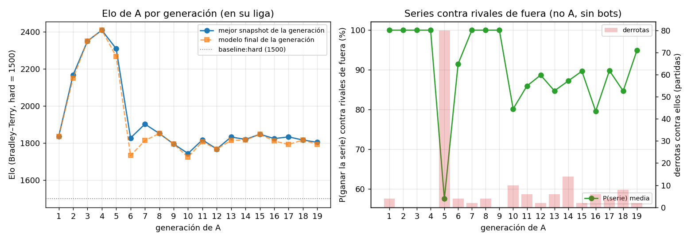
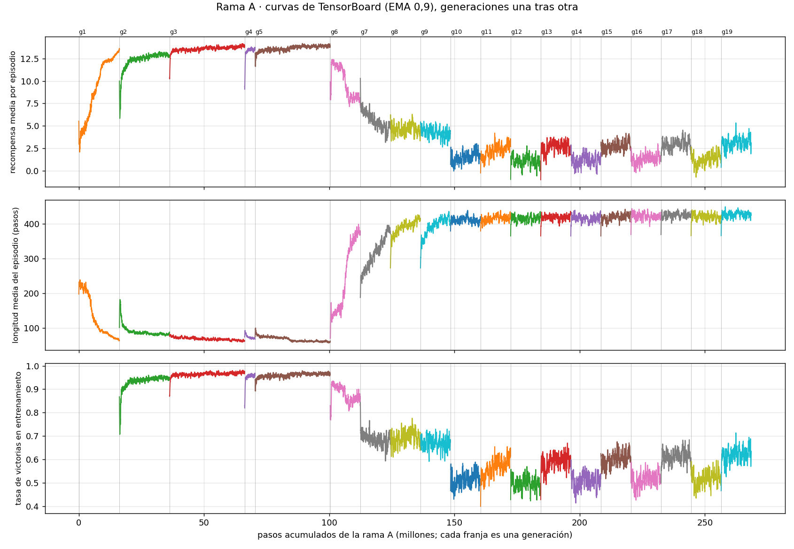
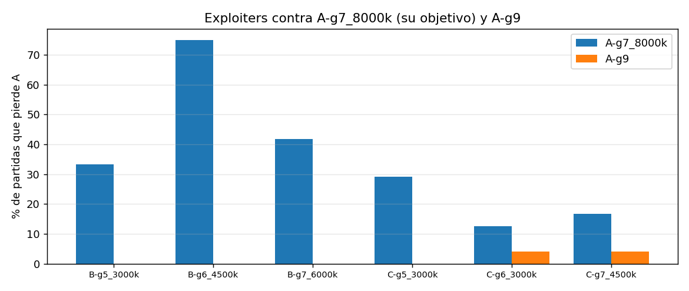
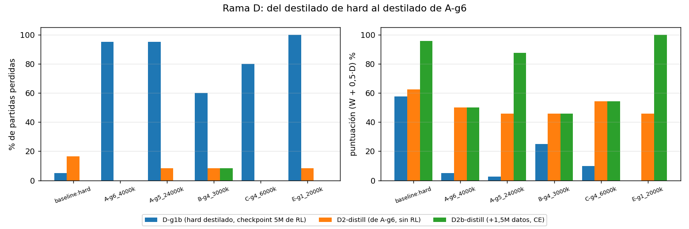

# Material para el informe · PC1

Generado por `student/report_figs.py` (no entrena nada). Todas las ramas parten de `baseline:hard` (con permiso del profesor). Partidas deterministas, como en el torneo.

## 1. Evolución de A por generación

Cada generación se mide en la última liga en la que es la generación de A más reciente. El Elo está anclado a `baseline:hard` = 1500, pero los rivales cambian de liga a liga: la comparación entre generaciones es aproximada. «Fuera» = participantes que no son A (B, C, D, E y los baselines; sin bots). P(serie) = media de oficiales (rondas) y aleatorios (final), regla del README, 500 series simuladas.

| gen | liga | mejor snapshot | Elo | final | Elo final | P(serie) fuera | derrotas fuera | rivales | win rate aleatorios | empates |
|---|---|---|---|---|---|---|---|---|---|---|
| 1 | 1 | A-g1_16000k | 1836 | A-g1_16000k | 1836 | 100% | 4 | 2 | 82% | 15% |
| 2 | 2 | A-g2_20000k | 2168 | A-g2 | 2150 | 100% | 0 | 2 | 84% | 11% |
| 3 | 3 | A-g3 | 2350 | A-g3 | 2350 | 100% | 0 | 2 | 76% | 15% |
| 4 | 4 | A-g4_4000k | 2409 | A-g4_4000k | 2409 | 100% | 0 | 6 | 95% | 6% |
| 5 | 5 | A-g5_24000k | 2309 | A-g5 | 2267 | 57% | 80 | 6 | 77% | 9% |
| 6 | 6 | A-g6_4000k | 1828 | A-g6 | 1733 | 92% | 4 | 6 | 64% | 38% |
| 7 | 7 | A-g7_8000k | 1903 | A-g7 | 1814 | 100% | 2 | 7 | 63% | 35% |
| 8 | 8 | A-g8 | 1852 | A-g8 | 1852 | 100% | 4 | 7 | 55% | 46% |
| 9 | 9 | A-g9 | 1795 | A-g9 | 1795 | 100% | 0 | 7 | 51% | 50% |
| 10 | 10 | A-g10_8000k | 1744 | A-g10 | 1725 | 80% | 10 | 9 | 40% | 55% |
| 11 | 12 | A-g11_8000k | 1818 | A-g11 | 1807 | 86% | 6 | 9 | 57% | 44% |
| 12 | 13 | A-g12 | 1768 | A-g12 | 1768 | 89% | 2 | 9 | 51% | 52% |
| 13 | 14 | A-g13_8000k | 1833 | A-g13 | 1815 | 85% | 6 | 10 | 52% | 48% |
| 14 | 15 | A-g14_8000k | 1820 | A-g14 | 1817 | 87% | 14 | 10 | 48% | 50% |
| 15 | 16 | A-g15 | 1848 | A-g15 | 1848 | 90% | 2 | 10 | 55% | 47% |
| 16 | 17 | A-g16_8000k | 1825 | A-g16 | 1812 | 80% | 6 | 10 | 47% | 50% |
| 17 | 18 | A-g17_8000k | 1834 | A-g17 | 1793 | 90% | 4 | 10 | 52% | 47% |
| 18 | 19 | A-g18 | 1817 | A-g18 | 1817 | 85% | 8 | 10 | 51% | 49% |
| 19 | 20 | A-g19_4000k | 1804 | A-g19 | 1794 | 95% | 2 | 10 | 48% | 51% |

## 2. Curvas de entrenamiento de A (TensorBoard)

Generaciones una tras otra en pasos acumulados. Cada generación arranca del A elegido en la liga anterior (no siempre del final de la anterior), contra un pool distinto, así que los saltos en las fronteras son cambios de rivales, no olvido. `success_rate` lo registra `pfsp.py` (últimos 100 episodios).

| gen | pasos | recompensa final | longitud final | victorias final |
|---|---|---|---|---|
| 1 | 16.2M | 13.52 | 62 | – |
| 2 | 20.0M | 12.70 | 96 | 95% |
| 3 | 30.0M | 13.38 | 60 | 95% |
| 4 | 4.2M | 13.10 | 74 | 94% |
| 5 | 30.0M | 14.82 | 55 | 100% |
| 6 | 12.0M | 6.44 | 336 | 78% |
| 7 | 12.0M | 5.36 | 352 | 71% |
| 8 | 12.0M | 4.99 | 417 | 72% |
| 9 | 12.0M | 4.27 | 414 | 69% |
| 10 | 12.0M | 1.09 | 412 | 52% |
| 11 | 12.0M | 2.70 | 440 | 62% |
| 12 | 12.0M | 1.38 | 408 | 55% |
| 13 | 12.0M | 2.86 | 428 | 61% |
| 14 | 12.0M | 2.77 | 396 | 58% |
| 15 | 12.0M | 2.54 | 424 | 61% |
| 16 | 12.0M | 1.76 | 436 | 53% |
| 17 | 12.0M | 3.21 | 453 | 66% |
| 18 | 12.0M | 1.04 | 440 | 53% |
| 19 | 12.0M | 4.27 | 425 | 70% |

## 3. Exploiters B y C (PC3)

Entrenados contra el A líder (a partir de la generación 5, contra **A-g7_8000k**). Se publica el mejor contra A que gane ≥ 85 % a hard (tablas de `results/exploiters_B.md` y `_C.md`).

| rama | gen | A rival | mejor snapshot | puntuación vs A | V-E-D vs A | vs hard | publicado |
|---|---|---|---|---|---|---|---|
| B | 2 | `A-g4_4000k` | `B-g2_6000k` | **100 %** | 40-0-0 | 100 % | `B-g2_6000k.zip` |
| B | 3 | `A-g4_4000k` | `B-g3_4500k` | **100 %** | 40-0-0 | 100 % | `B-g3_6000k.zip` |
| B | 4 | `A-g4_4000k` | `B-g4_3000k` | **100 %** | 40-0-0 | 90 % | `B-g4_3000k.zip` |
| B | 5 | `A-g7_8000k` | `B-g5_6000k` | **72 %** | 20-18-2 | 80 % | `B-g5_3000k.zip` |
| B | 6 | `A-g7_8000k` | `B-g6_4500k` | **92 %** | 34-6-0 | 90 % | `B-g6_4500k.zip` |
| B | 7 | `A-g7_8000k` | `B-g7_3000k` | **72 %** | 18-22-0 | 90 % | `B-g7_6000k.zip` |
| C | 2 | `A-g4_4000k` | `C-g2_6000k` | **95 %** | 36-4-0 | 90 % | `C-g2_6000k.zip` |
| C | 3 | `A-g4_4000k` | `C-g3_3000k` | **95 %** | 36-4-0 | 80 % | `C-g3_6000k.zip` |
| C | 4 | `A-g4_4000k` | `C-g4_6000k` | **100 %** | 40-0-0 | 90 % | `C-g4_6000k.zip` |
| C | 5 | `A-g7_8000k` | `C-g5_3000k` | **65 %** | 12-28-0 | 90 % | `C-g5_3000k.zip` |
| C | 6 | `A-g7_8000k` | `C-g6_1500k` | **55 %** | 4-36-0 | 80 % | `C-g6_3000k.zip` |
| C | 7 | `A-g7_8000k` | `C-g7_3000k` | **62 %** | 10-30-0 | 50 % | `C-g7_4500k.zip` |

### Qué encontraron en A-g7_8000k (576 partidas deterministas: 4 oficiales + 12 aug + 8 aleatorios, los dos lados; A-g9 como contraste)

| A | exploiter | W-D-L de A | derrotas de A por destrucción | daño de A / del exploiter | disparos A / exploiter | pasos medios en las derrotas | exploiter escondido |
|---|---|---|---|---|---|---|---|
| A-g7_8000k | B-g5_3000k | 2-30-16 | 62% | 0.88 / 1.25 | 20.6 / 59.7 | 399 | 0% |
| A-g7_8000k | B-g6_4500k | 2-10-36 | 33% | 0.33 / 1.58 | 24.6 / 55.9 | 429 | 0% |
| A-g7_8000k | B-g7_6000k | 6-22-20 | 40% | 0.62 / 1.17 | 18.5 / 40.5 | 393 | 0% |
| A-g7_8000k | C-g5_3000k | 0-34-14 | 57% | 0.21 / 0.83 | 27.4 / 25.8 | 288 | 1% |
| A-g7_8000k | C-g6_3000k | 0-42-6 | 33% | 0.00 / 0.25 | 23.0 / 18.7 | 369 | 1% |
| A-g7_8000k | C-g7_4500k | 2-38-8 | 0% | 0.04 / 0.21 | 16.7 / 32.8 | 500 | 0% |
| A-g9 | B-g5_3000k | 32-16-0 | – | 0.79 / 0.12 | 31.9 / 55.1 | – | 0% |
| A-g9 | B-g6_4500k | 22-26-0 | – | 0.67 / 0.21 | 35.0 / 55.6 | – | 0% |
| A-g9 | B-g7_6000k | 18-30-0 | – | 1.04 / 0.67 | 27.5 / 54.2 | – | 0% |
| A-g9 | C-g5_3000k | 6-42-0 | – | 0.12 / 0.00 | 22.2 / 26.9 | – | 0% |
| A-g9 | C-g6_3000k | 6-40-2 | 0% | 0.12 / 0.04 | 24.5 / 21.5 | 500 | 0% |
| A-g9 | C-g7_4500k | 2-44-2 | 0% | 0.08 / 0.08 | 21.9 / 39.5 | 500 | 0% |

**Lectura.** Las derrotas de A-g7_8000k llegan tarde (de media, entre 290 y 500 pasos) y entre el 38 % y el 100 % son por timeout, no por destrucción. **B** (agresiva) dispara 2–3 veces más que A, mete un impacto y gana por HP al final. **C** (superviviente) apenas hace daño (0,2–0,8 por partida), pero con uno basta: C-g7 gana todas sus partidas a los 500 pasos por el desempate de HP/daño. El agujero de A-g7_8000k era conformarse con el empate y no responder a un primer impacto. Con B y C en el pool, A-g9 ya no pierde contra B y pierde 2 de 48 contra C-g6 y 2 de 48 contra C-g7.

## 4. Rama D (LSTM, PC2): D-g1b → D2-distill → D2b-distill

Mismo agente RecurrentPPO; cambia el maestro de la destilación (hard → A-g6_4000k) y la cantidad de datos. W-D-L de las tablas de PC2 (D-g1b: 40 partidas por rival en aug + aleatorios; D2/D2b: 24 en oficiales + aleatorios). Puntuación = (W + 0,5·D) / partidas.

| modelo | baseline:hard | A-g6_4000k | A-g5_24000k | B-g4_3000k | C-g4_6000k | E-g1_2000k | puntuación | % derrotas |
|---|---|---|---|---|---|---|---|---|
| D-g1b (hard destilado, checkpoint 5M de RL) | 8-30-2 | 2-0-38 | 0-2-38 | 4-12-24 | 0-8-32 | 0-0-40 | 17% | 72% |
| D2-distill (de A-g6, sin RL) | 10-10-4 | 0-24-0 | 0-22-2 | 0-22-2 | 2-22-0 | 0-22-2 | 51% | 7% |
| D2b-distill (+1,5M datos, CE) | 22-2-0 | 0-24-0 | 18-6-0 | 0-22-2 | 2-22-0 | 24-0-0 | 72% | 1% |

Elo en las últimas ligas (hard = 1500):

| liga | D2b-distill | mejor D2-g1 | mejor A |
|---|---|---|---|
| 17 | 1686 | 1649 (D2-g1_8000k) | 1834 (A-g15) |
| 18 | 1670 | 1659 (D2-g1_10000k) | 1834 (A-g17_8000k) |
| 19 | 1660 | 1635 (D2-g1_10000k) | 1835 (A-g17_8000k) |
| 20 | 1653 | 1624 (D2-g1_18000k) | 1812 (A-g17_8000k) |
